<div align="center">


<br/>


<br/><br/>


</div>

---

## 👨‍💻 Sobre mí

Soy **Dalton**, desarrollador **Full-Stack** enfocado en construir aplicaciones y sistemas que resuelvan problemas reales.

Actualmente trabajo principalmente con **Node.js, TypeScript y React**, mientras profundizo en arquitectura de software, bases de datos, automatización e integración de IA.

```yaml
enfoque:
  - Desarrollo Full-Stack
  - APIs y arquitectura backend
  - Bases de datos
  - Automatización
  - IA aplicada al desarrollo
  - Linux + Docker

objetivo:
  Construir productos sólidos y crecer hacia oportunidades internacionales.
```

---

## ⚙️ Stack

<div align="center">

### Lenguajes


### Backend & Frontend


### Datos & Infraestructura


### Explorando


<br/>

`IA` · `Arquitecturas Multi-Agente`

</div>

---

## 🏗️ Proyectos destacados

### Portafolio StackRD

Páginas web y sistemas para negocios en Santiago, República Dominicana: [daltonarc.github.io/stackrd-web](https://daltonarc.github.io/stackrd-web/)

<table>
  <tr>
    <td align="center" valign="top" width="33%">
      <a href="https://daltonarc.github.io/stackrd-web/barberia/"></a><br/>
      <b>Barbería Filo Fino</b><br/>
      Reservas por WhatsApp
    </td>
    <td align="center" valign="top" width="33%">
      <a href="https://daltonarc.github.io/stackrd-web/restaurante/"></a><br/>
      <b>Sazón de la Loma</b><br/>
      Menú y pedidos
    </td>
    <td align="center" valign="top" width="33%">
      <a href="https://daltonarc.github.io/stackrd-web/consultorio/"></a><br/>
      <b>Clínica Dental Sonrisa Clara</b><br/>
      Servicios y citas
    </td>
  </tr>
  <tr>
    <td align="center" valign="top">
      <a href="https://daltonarc.github.io/stackrd-web/spa/"></a><br/>
      <b>Bella Esencia</b><br/>
      Reservas con total
    </td>
    <td align="center" valign="top">
      <a href="https://daltonarc.github.io/stackrd-web/taller/"></a><br/>
      <b>Rueda Firme</b><br/>
      Cotizador de servicios con factura electrónica
    </td>
    <td align="center" valign="top">
      <a href="https://daltonarc.github.io/stackrd-web/tienda/"></a><br/>
      <b>Nativa Studio</b><br/>
      Catálogo con carrito y factura electrónica
    </td>
  </tr>
  <tr>
    <td align="center" valign="top">
      <a href="https://daltonarc.github.io/stackrd-web/gimnasio/"></a><br/>
      <b>Forja Fitness</b><br/>
      Horario de clases y planes
    </td>
    <td align="center" valign="top">
      <a href="https://daltonarc.github.io/stackrd-web/inmobiliaria/"></a><br/>
      <b>Valle Alto</b><br/>
      Buscador de propiedades
    </td>
    <td align="center" valign="top">
      <a href="https://daltonarc.github.io/stackrd-web/colmado/"></a><br/>
      <b>El Surtido</b><br/>
      Pedidos con delivery y factura electrónica
    </td>
  </tr>
  <tr>
    <td colspan="3" align="center">
      <a href="https://daltonarc.github.io/stackrd-web/taller/#factura"><b>Demo de facturación electrónica e-CF</b></a><br/>
      Emisión de comprobantes fiscales electrónicos: <a href="https://daltonarc.github.io/stackrd-web/taller/#factura">ver la demo</a>
    </td>
  </tr>
</table>

### Sistemas a medida

Sistema de pedidos con panel de administración para un negocio de comida: catálogo editable, subida de fotos, registro de pedidos y despliegue con Docker. Node.js · Express · SQLite. Código privado de cliente.

### Repositorios

| Proyecto                                                       | Descripción                                         | Tecnologías                                        |
| -------------------------------------------------------------- | --------------------------------------------------- | -------------------------------------------------- |
| [**StackRD Web**](https://daltonarc.github.io/stackrd-web/)    | Portafolio y demos de páginas para negocios         | HTML · CSS · JavaScript                            |
| [**Rifadora**](https://github.com/DaltonARC/Rifadora)          | Plataforma para gestión de rifas y procesos de pago | React · Node.js · TypeScript · PostgreSQL · Prisma |
| [**La Percha**](https://github.com/DaltonARC/la-percha-tienda) | Catálogo online con carrito y pedidos vía Instagram | HTML · CSS · JavaScript                            |
| [**Todo Manager**](https://github.com/DaltonARC/Todo-Manager)  | Gestor de tareas                                    | Python                                             |

---

## 🤖 Actualmente explorando

* Arquitecturas multi-agente
* IA aplicada al desarrollo de software
* Automatización con **n8n**
* Modelos locales con **Ollama**
* Docker y self-hosting
* Arquitectura backend

---

## 📊 GitHub

<div align="center">



<br/><br/>



<br/><br/>

<picture>
  <source media="(prefers-color-scheme: dark)" srcset="https://streak-stats.demolab.com?user=DaltonARC&theme=dark&hide_border=true" />
  
</picture>

<br/><br/>


</div>

---

## 📌 Actividad reciente

<!--START_SECTION:activity-->
1. 🎉 Merged PR [#3](https://github.com/DaltonARC/stackrd-web/pull/3) in [DaltonARC/stackrd-web](https://github.com/DaltonARC/stackrd-web)
2. 💪 Opened PR [#3](https://github.com/DaltonARC/stackrd-web/pull/3) in [DaltonARC/stackrd-web](https://github.com/DaltonARC/stackrd-web)
3. 💪 Opened PR [#1](https://github.com/DaltonARC/stackrd-demo-la-percha/pull/1) in [DaltonARC/stackrd-demo-la-percha](https://github.com/DaltonARC/stackrd-demo-la-percha)
4. 🎉 Merged PR [#2](https://github.com/DaltonARC/stackrd-web/pull/2) in [DaltonARC/stackrd-web](https://github.com/DaltonARC/stackrd-web)
5. 💪 Opened PR [#2](https://github.com/DaltonARC/stackrd-web/pull/2) in [DaltonARC/stackrd-web](https://github.com/DaltonARC/stackrd-web)
<!--END_SECTION:activity-->

<sub>Esta lista se actualiza sola cada 30 minutos con mis últimos eventos públicos en GitHub.</sub>

---

## 📈 Métricas avanzadas

<div align="center">


</div>

<sub>Calendario de actividad, lenguajes y hábitos de código, generados automáticamente cada día.</sub>

---

## 🎯 Hacia dónde voy

Construir experiencia sólida mediante **proyectos reales**, mejorar continuamente mis fundamentos de ingeniería de software y desarrollar un perfil preparado para trabajar en **equipos y proyectos internacionales**.

---

<div align="center">

### Construyendo · Aprendiendo · Iterando

<br/>


<br/><br/>


</div>
